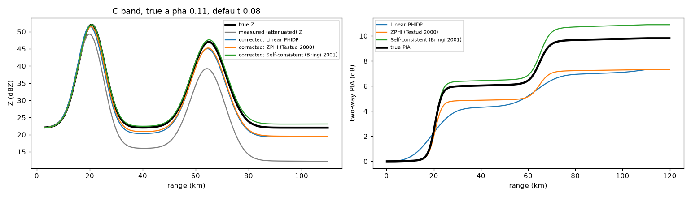
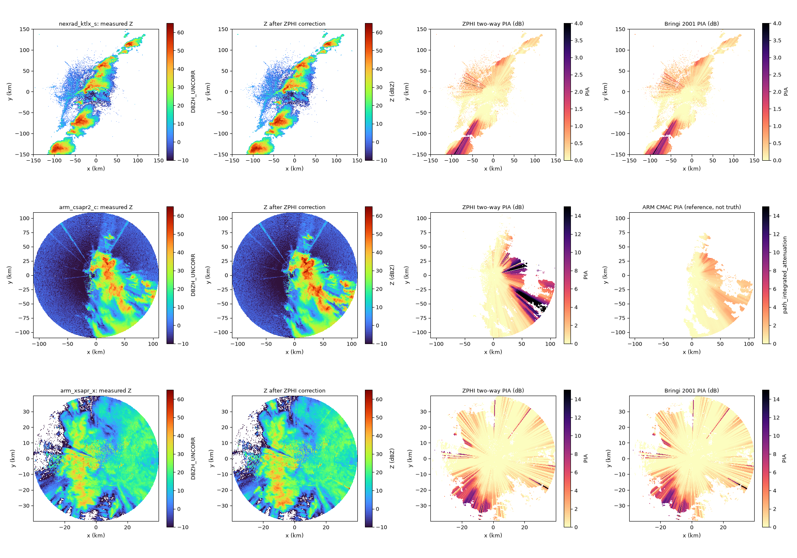
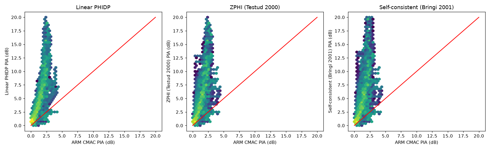

# radarwow-attenuation

**radar-wow stage 4: Attenuation correction.** Path-integrated and differential attenuation in rain (critical at C and X band).

Part of [radar-wow](https://github.com/manmeet3591/radar-wow), a set of repos that together build a radar QPE system that works for S, C and X band radars.
Every algorithm is one class implementing one paper, with the same interface: it takes an xradar sweep or volume with canonical moment names, declares the bands and moments it needs, and records provenance.

## Sub-components

| sub-component | algorithm | source | DOI | status |
|---|---|---|---|---|
| linear A = alpha KDP | `LinearPhiAttenuation` | baseline: PIA = alpha PHIDP, alpha per band in `core/bands/*.toml` |  | implemented + notebook |
| ZPHI (PHIDP-constrained) | `Testud2000ZPHI` | Testud et al. 2000, JTECH | [doi:10.1175/1520-0426(2000)017<0332:TRPAAT>2.0.CO;2](https://doi.org/10.1175/1520-0426(2000)017<0332:TRPAAT>2.0.CO;2) | implemented + notebook |
| self-consistent alpha per ray | `Bringi2001SelfConsistent` | Bringi, Keenan & Chandrasekar 2001, IEEE TGRS | [doi:10.1109/36.951081](https://doi.org/10.1109/36.951081) | implemented + notebook |
| ZDR constraint for beta | - | Bringi, Keenan & Chandrasekar 2001 | [doi:10.1109/36.951081](https://doi.org/10.1109/36.951081) | planned |
| hail / melting-layer attenuation, wet radome | - | see survey/02 |  | to review |

## Install

```bash
pip install git+https://github.com/manmeet3591/radarwow-core git+https://github.com/manmeet3591/radarwow-attenuation
```

## Notebooks (free data, S / C / X band)

- [`notebooks/01_attenuation_s_c_x.ipynb`](notebooks/01_attenuation_s_c_x.ipynb): open in Colab via `https://colab.research.google.com/github/manmeet3591/radarwow-attenuation/blob/main/notebooks/01_attenuation_s_c_x.ipynb`

## Results





## Usage

```python
from radarwow.core import load_sample
from radarwow.attenuation import *  # see table above

vol = load_sample('arm_csapr2_c')        # or open_volume('my_file')
# out = SomeAlgorithm()(vol)            # band read from the file, or band='S'|'C'|'X'
```

## Status legend

*implemented + notebook*: code, tests, executed notebook. *planned*: interface fixed, code to write. *stub*: class exists, raises `NotImplementedError`. *to review*: paper to read before deciding.

## License

MIT. Data used in the notebooks comes from public archives (NEXRAD on AWS, ARM, IMD via open-radar-data) under their own terms.
